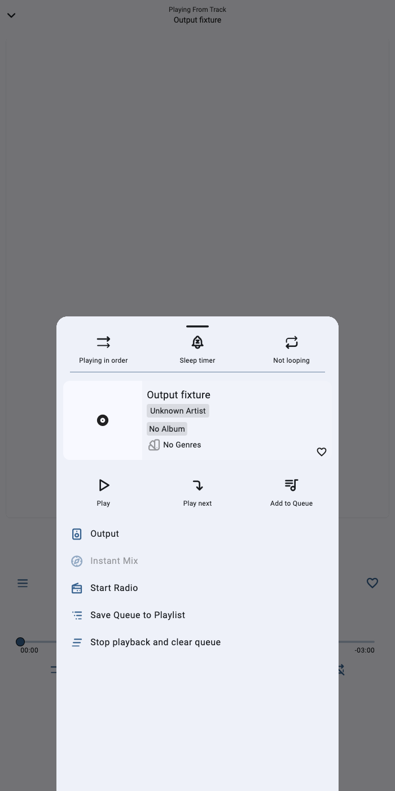
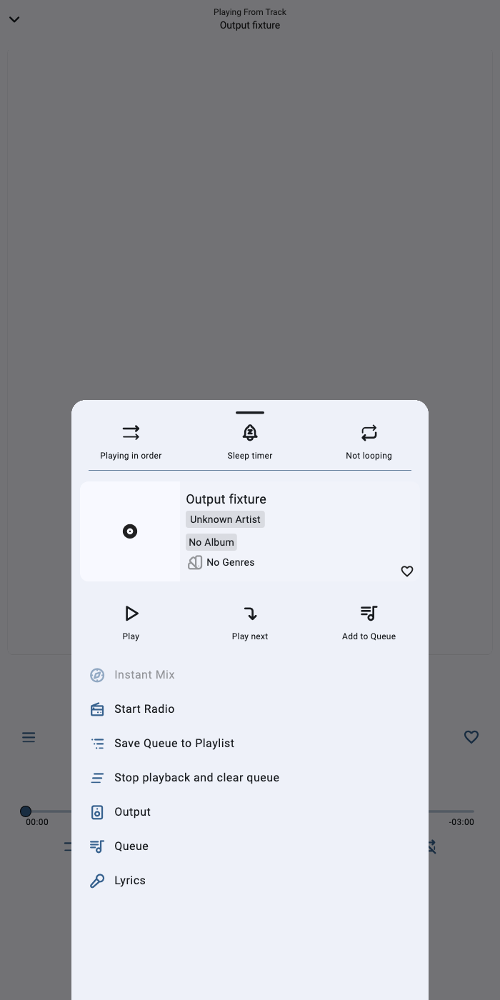
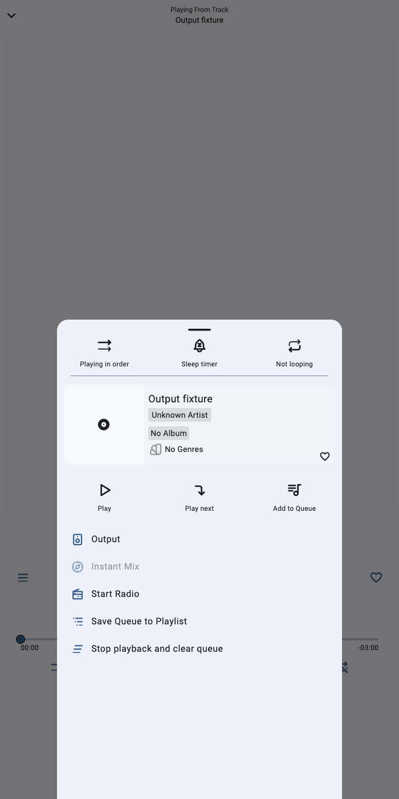
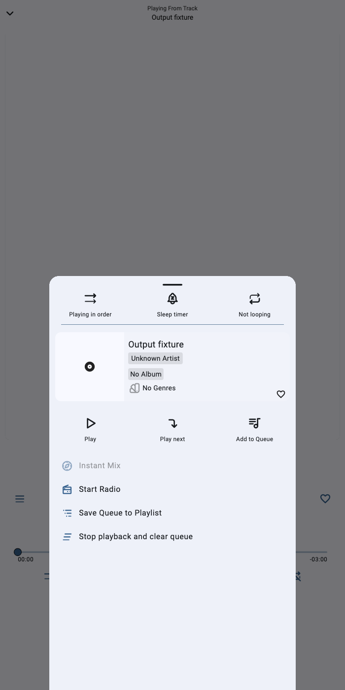

# Player action menu — PR #1836

These are unedited captures of the real PlayerScreen, TrackMenu and destination widgets in Flutter's macOS widget tester. Only audio, queue, downloads, user and metadata services use synthetic fixtures; there is no Jellyfin connection or real audio/device-routing test here.

- **Before:** previous PR revision `0aebf3d33ebcddc4641685d9a092244b4055045d`.
- **After:** implementation `f731afb2273813002ab1e8dda96628fe8eafdb2a` (later evidence-only commits do not change production behavior).
- Both revisions use the identical regression test file from the after revision, SHA-256 `a171024ebbf2e57268cb11413f3853470292b7231dab8c588b1598f9d32eb099`.
- Flutter 3.47.8 / Dart 3.13.7; 700 × 1400 logical pixels, DPR 1, English, offline synthetic track, gestures disabled. Captures load Flutter's bundled Roboto font, also under the Apple system-font alias used by the sheet's own theme. No image editing or compositing.

## Hidden bottom actions

Before, Output is first and Queue/Lyrics have no menu entry. After, the fallback group is at the bottom, in Output → Queue → Lyrics order.

| Before | After |
| --- | --- |
|  |  |

## Visible bottom actions

All three actions remain in the player's bottom row. The updated menu contains no duplicate entries.

| Before | After |
| --- | --- |
|  |  |

## Navigation

[Output and volume](output-opened-after.png) · [Queue](queue-opened-after.png).

Lyrics content and its named route are verified by the regression test. Each action dismisses the track menu before opening its existing destination; Back returns directly to the player. On the lyrics screen, its menu retains Output and Queue without offering Lyrics again.

## Regression evidence

The same 27 production-widget cases produce **5 passes / 22 failures before**, then **27 passes / 0 failures after**. The complete source test suite passes **52/52** after.

Covered: the hidden/visible bottom row × enabled/disabled gestures × menu-button/artwork entry matrix; wide landscape and compact layouts with automatic hiding; loading, missing and failed lyrics metadata; library and old default callers; destination route stacks and Back; queue/lyrics/player-dismiss swipes; avoiding duplicate lyrics routes. No stored-setting fields, defaults, Hive adapters or generated persistence code change.

Run from each checkout, with the same after-version test file overlaid on the before checkout:

```sh
flutter pub get --offline
flutter test --no-pub test/player_output_access_test.dart --reporter expanded
```

To reproduce captures, run the following **sequentially within each checkout** (Flutter's test compiler uses a shared per-checkout cache). Set `stage` to `before` or `after`, `evidence_dir` to an absolute writable directory, and `font` to the Flutter SDK's `bin/cache/artifacts/material_fonts/Roboto-Regular.ttf`.

```sh
flutter test --no-pub test/player_output_access_test.dart \
  --plain-name 'capture player menu' --update-goldens \
  --dart-define=EVIDENCE_STAGE="$stage" \
  --dart-define=EVIDENCE_DIR="$evidence_dir" \
  --dart-define=EVIDENCE_FONT="$font" --reporter expanded
```

For after-only destination captures, replace `--plain-name 'capture player menu'` with `--name 'replaces the menu'`.

Validation: full `lib/` and `test/` formatting is unchanged; analysis of the three action entries and test has no issues; analysis of all touched files reports only the pre-existing `use_null_aware_elements` info in TrackMenu; build_runner completes with no generated-file changes. The branch merges cleanly with `redesign` at `5afdf765`.
